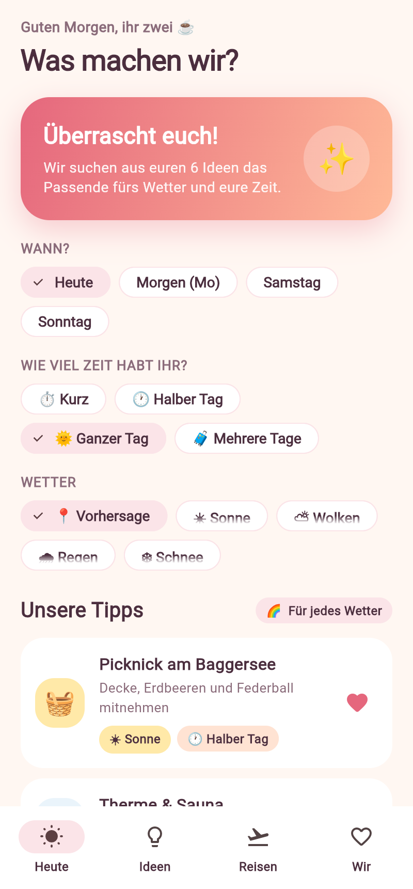
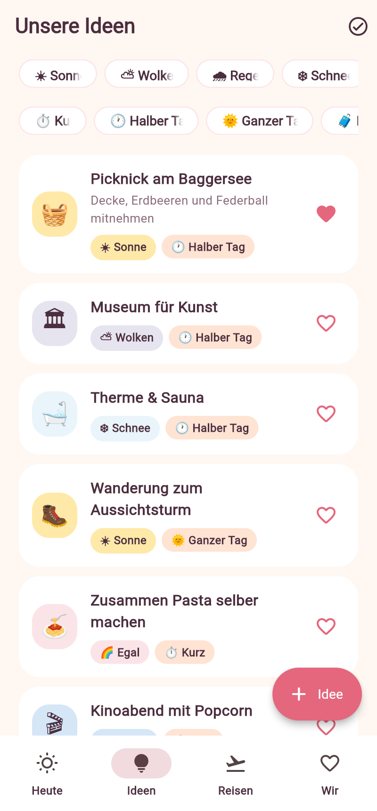
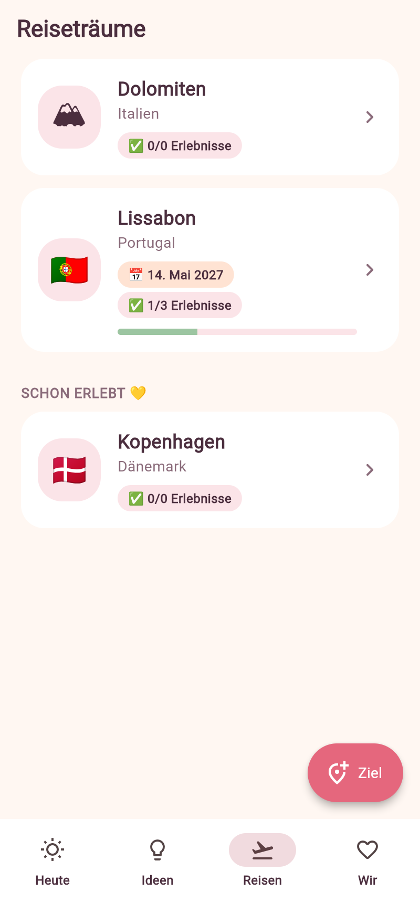
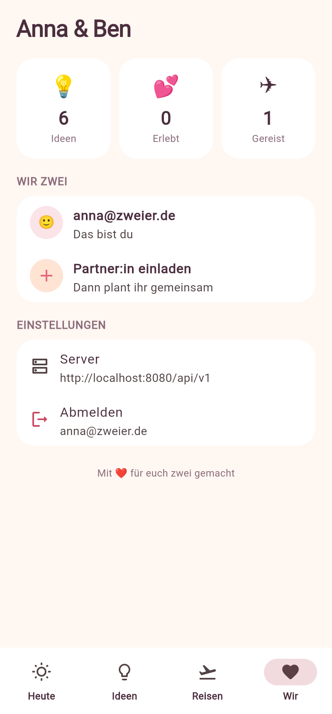

# Zweier 💞

Repository: https://github.com/wertania/zweier-app

Eine Android-App für Paare: Ideen für die gemeinsame Freizeit sammeln, nach
**Wetter** und **Dauer** sortieren, **Reiseziele** mit einer kleinen
Erlebnis-Liste pflegen und sich z. B. Samstagmorgens **Tipps geben lassen** –
passend zur Wettervorhersage und zur Zeit, die ihr habt.

| Login | Heute | Ideen | Reisen | Wir |
|---|---|---|---|---|
|  |  |  |  |  |

## Aufbau

- `backend/` – Bun + Hono API auf dem [symbiosika-framework](https://github.com/symbiosika/symbiosika-framework)
  (erstellt mit `@symbiosika/create-app`, Framework als Submodul in `backend/framework`).
- `app/` – Flutter-App (Android).

Ein Paar ist ein **Tenant** des Frameworks: einer legt den Bereich an und lädt
den Partner per E-Mail ein; der Partner nimmt die Einladung in der App an.

### Datenmodell

| Tabelle | Inhalt |
|---|---|
| `app_ideas` | Freizeit-Idee: Titel, Notiz, Emoji, `weather` (sunny/cloudy/rainy/snowy/any), `duration` (short/half_day/full_day/multi_day), Herzensidee, erledigt. Mit `destinationId` ist sie ein Eintrag auf der Erlebnis-Liste eines Reiseziels – gleiche Einträge wie für den normalen Samstag. |
| `app_destinations` | Reiseziel: Name, Land, Emoji, geplantes Datum, „waren wir schon“. |

### API (`/api/v1`, JWT-geschützt, nur für Mitglieder des Paares)

- `GET/POST /tenant/:tenantId/ideas` (`?destinationId=none|<id>&weather=&duration=`), `GET/PUT/DELETE /tenant/:tenantId/ideas/:id`
- `GET/POST /tenant/:tenantId/destinations` (inkl. `todoCount`/`doneCount`), `GET/PUT/DELETE /tenant/:tenantId/destinations/:id`
- `GET /tenant/:tenantId/suggestions?maxDuration=&weather=&latitude=&longitude=&date=&count=` –
  ohne `weather` wird die Vorhersage für den Tag bei [Open-Meteo](https://open-meteo.com) (ohne API-Key) abgefragt.
  Herzensideen und passendes Wetter werden bevorzugt, kürzlich Erledigtes nach hinten gestellt.

Login in der App per E-Mail-Code (`/user/register` + `/user/request-login-code` + `/user/login-with-code`).
Dafür muss im Backend SMTP konfiguriert sein (lokal: `SMTP_HOST=console.localhost`, der Code steht dann im Server-Log).

## Entwicklung

```bash
git clone --recurse-submodules https://github.com/wertania/zweier-app.git

# Backend
cd backend && bun install && bun run init
bun run db:local          # eingebettete Postgres (PGlite), alternativ: bun run docker:up
bun run migrate
bun run dev               # http://localhost:3000
bun run test:local        # Tests gegen eingebettete DB

# App
cd ../app
flutter pub get
flutter run                                                     # Emulator: Backend unter http://10.0.2.2:3000/api/v1
flutter run --dart-define=API_BASE_URL=https://dein-server/api/v1
flutter build apk --dart-define=API_BASE_URL=https://dein-server/api/v1
```

Die Server-URL lässt sich auch in der App auf dem Login-Bildschirm ändern.

## Framework aktualisieren

```bash
git submodule update --remote backend/framework
cd backend && bun run sync-deps && bun run sync-skills && bun install
```
