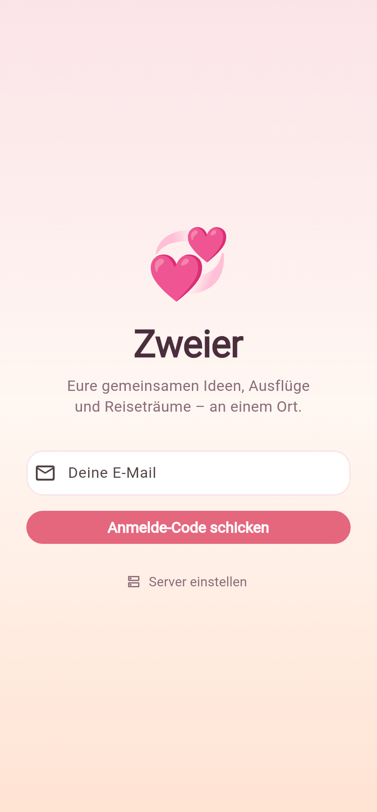
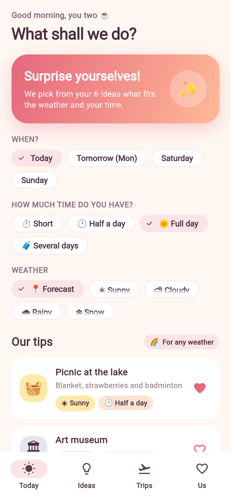
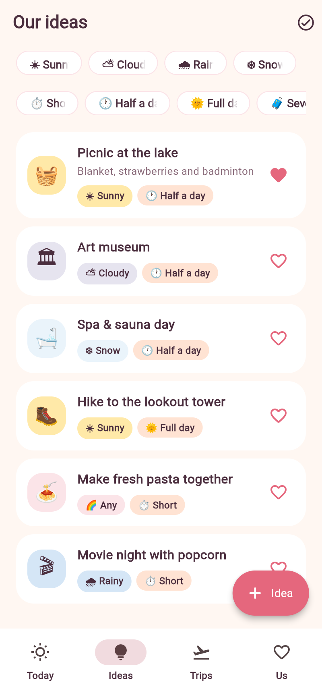
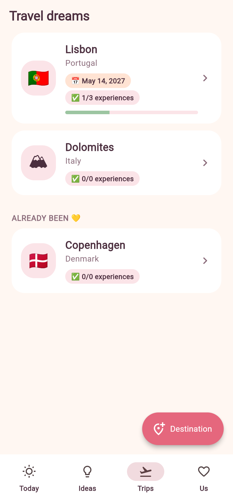
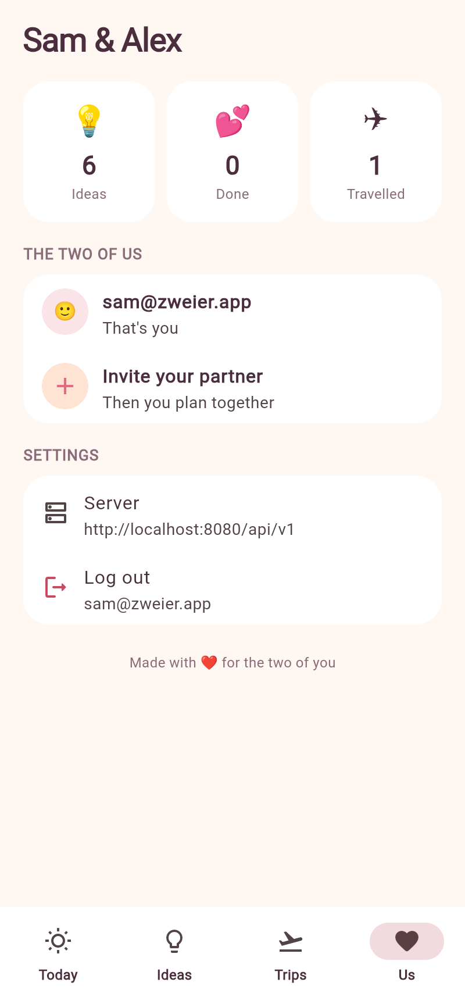

<p align="center">
  
</p>

<h1 align="center">Zweier 💞</h1>

<p align="center">
  A cosy Android app for couples: collect ideas for your time together, keep a list of travel dreams
  and let the app suggest what to do on a Saturday morning – based on the weather forecast and the time you have.
</p>

<p align="center">
  <a href="../../releases/latest">Download the latest APK</a> ·
  <a href="#self-hosting">Self-hosting</a> ·
  <a href="CONTRIBUTING.md">Contributing</a>
</p>

| Login | Today | Ideas | Trips | Us |
|---|---|---|---|---|
|  |  |  |  |  |

## Features

- **Ideas** for free days, tagged by one or more **weathers** (sunny, cloudy, rainy, snow, any), **duration**
  (short, half a day, full day, several days), **time of day** (daytime, evening) and optional **categories** (hustle & city, outdoor, with friends, culture),
  with an optional **place**
  that opens in your maps app. Mark favourites ("heart ideas") and tick off what you did.
- **Travel destinations** with a planned date and a to-do list of things to experience there – the
  entries are the same kind of ideas you use for a normal Saturday.
- **Suggestions**: pick a day and how much time you have; the backend checks the
  [Open-Meteo](https://open-meteo.com) forecast for your location (no API key) and picks fitting ideas,
  preferring favourites and pushing recently done ones back.
- **Shared space for two**: one partner creates the space and invites the other by email.
- **Update hint**: the app asks the server for the newest version (`GET /api/v1/app/version`, taken from the latest
  GitHub release or `APP_LATEST_VERSION`) and asks you to update; with `APP_MIN_VERSION` the update becomes mandatory.
- Passwordless login with an email code. English and German UI.

## Repository layout

| Path | What |
|---|---|
| `app/` | Flutter Android app |
| `backend/` | Bun + Hono API on the [symbiosika-framework](https://github.com/symbiosika/symbiosika-framework) (git submodule in `backend/framework`, Apache-2.0) |
| `deploy/` | `docker-compose.yml` and `.env.example` for self-hosting |
| `.github/workflows/` | CI, APK release and Docker image workflows |

### Data model

| Table | Content |
|---|---|
| `app_ideas` | Title, notes, emoji, `location`, `weathers` (list), `duration`, `timeOfDay`, `categories` (list), favourite, done. With a `destinationId` the idea is a to-do of that destination. |
| `app_destinations` | Name, country, emoji, planned date, visited. |

A couple is a *tenant* of the framework; all data is scoped to it.

### API (`/api/v1`, JWT, tenant members only)

- `GET/POST /tenant/:tenantId/ideas` (`?destinationId=none|<id>&weather=&duration=&timeOfDay=&category=`), `GET/PUT/DELETE /tenant/:tenantId/ideas/:id`
- `GET/POST /tenant/:tenantId/destinations` (includes `todoCount`/`doneCount`), `GET/PUT/DELETE /tenant/:tenantId/destinations/:id`
- `GET /tenant/:tenantId/suggestions?maxDuration=&timeOfDay=&category=&weather=&latitude=&longitude=&date=&count=`

Authentication, tenants and invitations come from the framework (`/user/request-login-code`,
`/user/login-with-code`, `/tenant/:id/invite`, …).

## Self-hosting

The app connects to `https://zweier-app.resomo.de` by default. To use your own backend, tap *Set server* on the
login screen and enter its address (e.g. `zweier.example.com` – `https://` and the API path `/api/v1` are added
automatically). Release builds only talk HTTPS, so put a reverse proxy with TLS
(Caddy, Traefik, nginx, …) in front of the backend.

### Docker (recommended)

The backend is published as a multi-arch image (amd64/arm64) at
[`ghcr.io/wertania/zweier-app`](https://github.com/wertania/zweier-app/pkgs/container/zweier-app):

```bash
mkdir zweier && cd zweier
curl -O https://raw.githubusercontent.com/wertania/zweier-app/main/deploy/docker-compose.yml
curl -o .env https://raw.githubusercontent.com/wertania/zweier-app/main/deploy/.env.example
# fill in the secrets and SMTP settings in .env (login codes are sent by email)
docker compose up -d
```

Migrations run automatically on every start. Image tags: `latest` (main), `1.2.3` / `1.2` (releases) and `sha-…`.
Build it yourself with `docker build -t zweier-backend .` from the repository root.

### Without Docker

```bash
git clone --recurse-submodules https://github.com/wertania/zweier-app.git
cd zweier-app/backend
bun install
bun run init              # generates secrets into .env
# configure POSTGRES_* and SMTP_* in .env
bun run migrate
bun run build && bun ./dist/index.js
```

## Development

```bash
# backend
cd backend
bun install && bun run init
bun run db:local          # embedded Postgres (PGlite); or `bun run docker:up`
bun run migrate
bun run dev               # http://localhost:3000, SMTP_HOST=console.localhost prints login codes to the log
bun run test:app          # app tests against an embedded database (test:local = incl. framework)

# app
cd app
flutter pub get
flutter run --dart-define=SERVER_URL=http://10.0.2.2:3000   # local backend from the Android emulator
flutter run                                                 # default server: https://zweier-app.resomo.de
```

Translations live in `app/lib/l10n/app_*.arb` – adding a language is a new ARB file.

## Releasing

Push a tag like `v1.0.0`: the [release workflow](.github/workflows/release.yml) builds the APK and attaches it to a
GitHub release, and the [Docker workflow](.github/workflows/docker.yml) publishes the backend image as `1.0.0`.
Every push to `main` that touches the backend updates the `latest` image. To sign with your own key (needed for in-place updates), add these repository secrets:
`ANDROID_KEYSTORE_BASE64`, `ANDROID_KEYSTORE_PASSWORD`, `ANDROID_KEY_ALIAS`, `ANDROID_KEY_PASSWORD`.
Without them the APK is signed with a throwaway debug key. The optional repository variable `SERVER_URL`
changes the default server built into the app.

Locally, put the same values into `app/android/key.properties` (`storeFile`, `storePassword`, `keyAlias`, `keyPassword`).

## License

[MIT](LICENSE). The bundled framework submodule is licensed under Apache-2.0.
